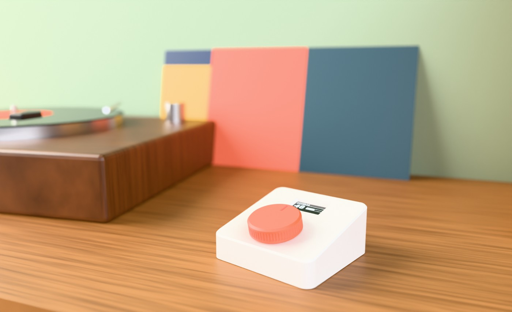
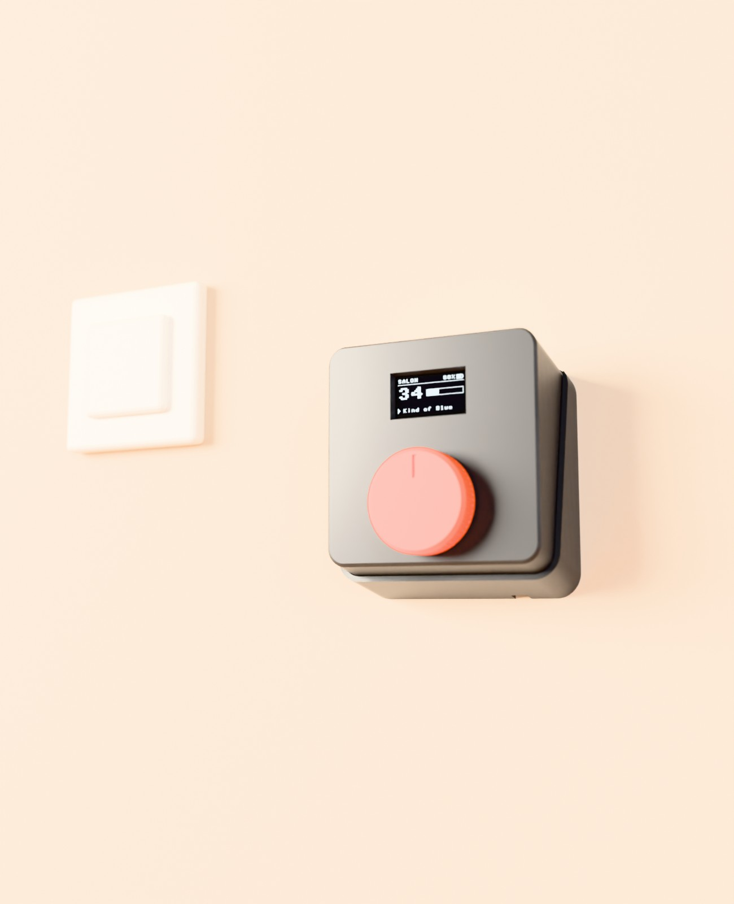
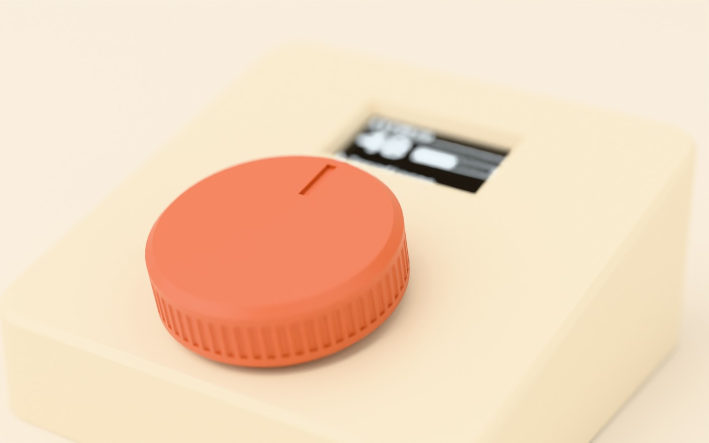
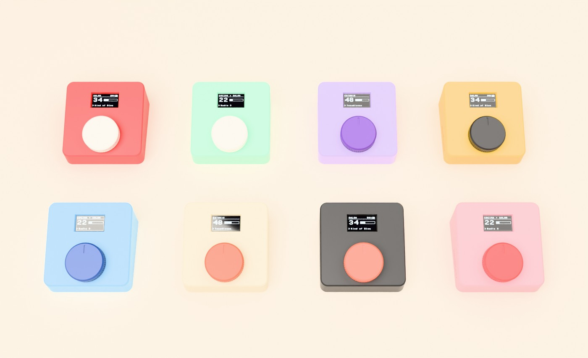

  

<strong>A physical volume knob for Sonos.</strong> 
Turn it to change the volume. Press it to pause. No phone, no tablet, no app.

  <a href="https://knobeast.com/en/">Website</a> ·
  <a href="https://knobeast.com/en/#buy">Buy it ready-made (€149)</a> ·
  <a href="docs/build-guide.md">Build your own</a> ·
  <a href="README.es.md">Español</a>

  
  
  
  

## What is knobeast?

knobeast is a small box with a **big dial** and a **little screen** that controls the volume of your **Sonos** speakers over your home Wi-Fi.

- **Turn** the dial to change the volume, one step at a time.
- **Press** it to pause or resume.
- **Hold** it 2 s to pick speakers, 4 s to open the menu.
- **The screen** shows the room, the volume and what's playing.

It is a **minimalist, physical way to control your music** that doesn't depend on a phone or a tablet. Anyone in the family can use it, including kids, grandparents and guests: nobody needs the app, an account or a password.

## Who is it for?

knobeast works with **any Sonos system**. It makes the most sense in setups where there is **no volume control at hand**:

| Your setup | Why knobeast helps |
|---|---|
| **Sonos Port + turntable, CD or other analogue sources** | The Port has no volume buttons. When part of your system is analogue, knobeast gives it back a real knob. |
| **Sonos Port + non-Sonos speakers** (Bang & Olufsen Beolab, Genelec, KEF, Dynaudio… or an amplifier) | With the Port's line-out set to *Variable*, knobeast becomes the volume knob of your speakers. |
| **Sonos Amp + ceiling or in-wall speakers** | Built-in speakers have no controls. Mount a knobeast on the wall next to the light switch. |
| **Sonos speakers you already love** | Add a second control point in another room, or simply a beautiful object for your home. |

It can control one room, several rooms at once, or a Sonos group. Pick them on the knob itself.

  
  
  

## Features

- **Local and private:** it talks directly to your Sonos speakers on your network (UPnP/SOAP on port 1400). No cloud, no account, no telemetry.
- **Multi-room:**
  - control single speakers, several rooms at once, or a whole Sonos group;
  - speakers with the same name are told apart by model;
  - fixed line-outs are detected and skipped.
- **Easy setup:**
  - on first boot the screen shows a WPA2 setup network with a unique, per-device password and a QR code;
  - scan it with your phone or connect from a computer, then pick your Wi-Fi.
- **Updates:**
  - this community edition never connects to any server: you update it by hand whenever you like, over USB or wirelessly from its settings page;
  - if a new version fails to boot, the device goes back to the previous one;
  - ready-made units from knobeast.com get automatic, signed updates.
  - Running your own signed update server is supported too (Ed25519, HTTPS, anti-rollback).
- **Your rules:**
  - maximum volume limit;
  - volume step of 1, 2, 3 or 5;
  - screen dimming and sleep times.
- **Six languages:** English, Spanish, French, German, Italian and Portuguese.
- **On a table or on the wall:**
  - the case sits at 13° on a table;
  - with the wall bracket, which cancels out the angle, it sits flat on the wall, held by magnets;
  - the USB-C cable is hidden underneath.
- **Battery optional:** runs from any USB-C charger, with an optional internal LiPo.

## Get one

| | |
|---|---|
| **Ready-made** | Assembled, flashed and tested, printed in the colours you choose, wall bracket included, with automatic updates. **€149, VAT included**, at **[knobeast.com](https://knobeast.com/en/#buy)**. |
| **Build your own** | Everything is in this repository. The parts cost little and are easy to find. Follow the **[build guide](docs/build-guide.md)**. |

## Build your own: quick overview

**Parts**

- Raspberry Pi Pico 2 W;
- KY-040 rotary encoder;
- 1.3" SH1106 I²C OLED;
- optional: TP4056 USB-C charger, LiPo 802540 battery and KCD11 switch;
- a 3D-printed case.

**Wiring**

**Case:** `caja/` contains the editable OpenSCAD design and ready-to-print STL files:
- `knobeast_1_carcasa` (case);
- `knobeast_2_tapa_inferior` (bottom lid);
- `knobeast_3_pomo` (knob);
- `knobeast_4_soporte_pared` (wall bracket).

PLA, 0.2 mm layers, no supports.

**Firmware:** MicroPython. Install it with `bash instalar_mac.sh` (macOS; it uses `mpremote`, which also runs on Linux and Windows). It flashes MicroPython and copies `pico/`. New features land here on GitHub. To update, download the new version and copy it over USB or from the device's settings page; see [Updates](docs/build-guide.md#7-updates).

**[→ Full build guide](docs/build-guide.md)**

## Repository layout

| Folder / file | Contents |
|---|---|
| `pico/` | Firmware (MicroPython). `config.py` holds pins and defaults; Wi-Fi and speakers are set up from the device |
| `caja/` | Case: OpenSCAD source and STL files |
| `docs/` | Build guide (EN/ES), wiring, dimensions, images |
| `marca/` | knobeast logo (see [TRADEMARK.md](TRADEMARK.md)) |
| `render3d/` | Blender scripts used for the product renders |
| `instalar_mac.sh` | First install: flashes MicroPython and copies the firmware |
| `publicar_actualizacion.py` | Signs a release and publishes it to your own update server |
| `prueba_mac.py` | Finds your Sonos rooms and tests volume control from a computer |
| `diagnostico_mac.sh` | 25-second USB diagnostic run |
| `prueba_wifi_mac.sh` | USB Wi-Fi test: networks seen, saved name and the exact connection error |
| `prueba_bateria_mac.sh` | USB test of the battery and charging resistors |

The code comments and the Spanish UI texts come first because the project was born in Spain. English translations of comments are welcome.

## Open source, and where it could go

Today knobeast controls Sonos volume. The dial and the screen can do much more, and contributions are welcome:
- favourite stations and playlists;
- Home Assistant scenes;
- other multi-room audio systems;
- new case designs;
- more languages.

See [CONTRIBUTING.md](CONTRIBUTING.md).

## Licences

| Part | Licence |
|---|---|
| Firmware and scripts (`pico/`, `*.py`, `*.sh`, `render3d/`) | [GNU GPL v3.0](LICENSE) |
| Hardware design (`caja/`, wiring and dimension drawings) | [CERN Open Hardware Licence v2 – Strongly Reciprocal](LICENSES/CERN-OHL-S-2.0.txt) |
| Documentation and images (`docs/`, `README*`) | [CC BY-SA 4.0](LICENSES/CC-BY-SA-4.0.txt) |
| Name and logo «knobeast» (`marca/`) | Trademark, **not** covered by the licences above: see [TRADEMARK.md](TRADEMARK.md) |

You may build, modify, share and even sell devices based on this project under these licences. Please don't call them «knobeast» or use the logo.

## Contact

- General questions, business, press: **contact@knobeast.com**
- Security issues: **security@knobeast.com**. Please read [SECURITY.md](SECURITY.md) first and don't open a public issue.
- Bugs and ideas: [GitHub issues](https://github.com/knobeast/knobeast/issues)

Ready-made units are sold at [knobeast.com](https://knobeast.com) by DSM Beauty, S.L. (Málaga, Spain).

---

Sonos, Sonos Port and Sonos Amp are trademarks of Sonos, Inc. Bang & Olufsen and Beolab are trademarks of Bang & Olufsen A/S. Other trademarks belong to their owners and are mentioned only to describe compatibility. knobeast is an independent project, not affiliated with or endorsed by Sonos or Bang & Olufsen.
