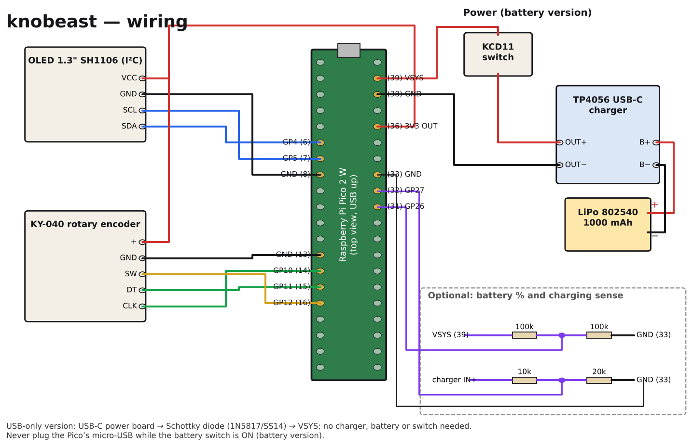
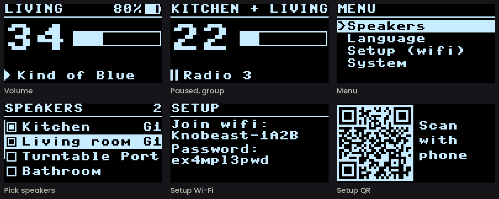
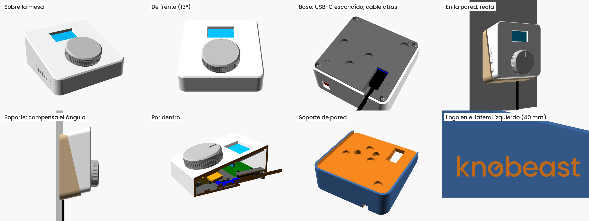
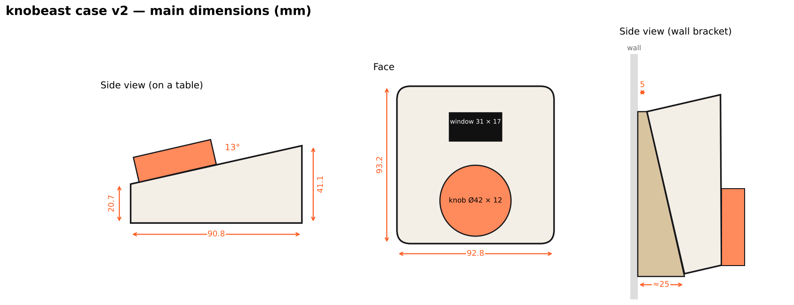
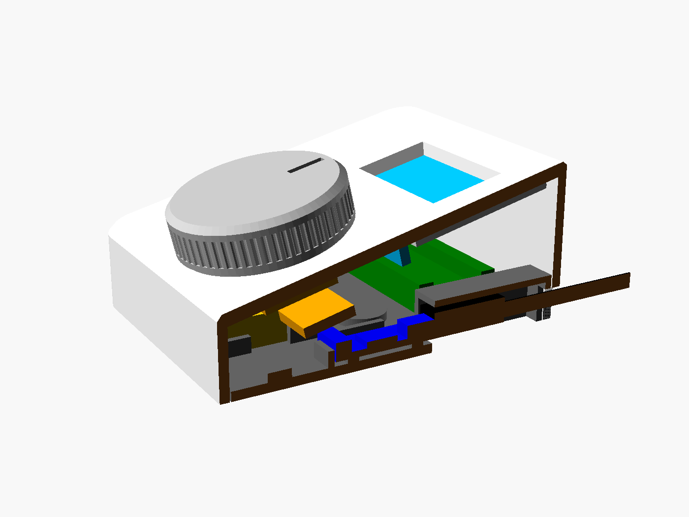
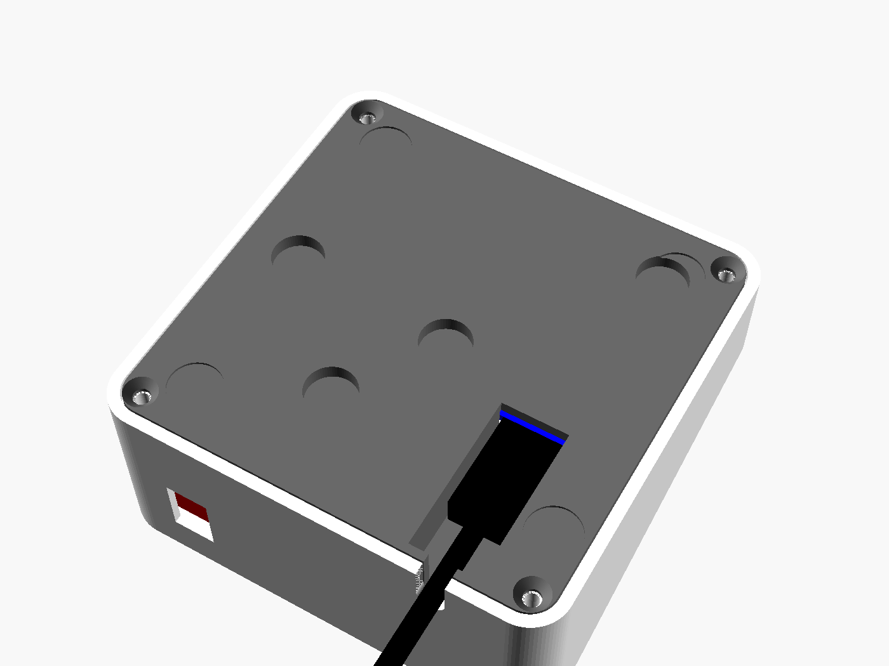

# knobeast build guide

*[Versión en español](guia-montaje.md)*

This guide walks you through building a knobeast from scratch: parts, wiring, flashing, setup, printing the case and assembly. If you'd rather not solder or flash anything, you can buy one ready-made at [knobeast.com](https://knobeast.com/en/#buy).

---

## 1. Parts

| Part | Notes |
|---|---|
| Raspberry Pi Pico 2 W | With Wi-Fi. The firmware is written and tested for the Pico 2 W (RP2350) |
| KY-040 rotary encoder | With push button. 6 mm “D” shaft (or knurled: change `shaft` in the `.scad`) |
| 1.3" SH1106 OLED, I²C | The 4-pin one (VCC, GND, SCL, SDA), 128 × 64 |
| 4 × M2 × 5 self-tapping screws | Hold the display from inside |
| 4 × M3 × 8 countersunk screws | Close the bottom lid |
| 4 × Ø10 mm rubber feet | Optional |
| Thin wire, soldering iron, solder | |

**Battery version**
- TP4056 USB-C charger (17 × 26 mm, HW-373 type, with protection);
- 802540 LiPo, 1000 mAh;
- KCD11 mini rocker switch (8.8 × 13.2 mm cut-out).

**USB-C-only version**
- A power-only USB-C board, with the 5.1 kΩ CC resistors;
- a 1N5817 or SS14 Schottky diode.

**Wall bracket (optional)**
- 8 × Ø10 × 3 mm neodymium magnets;
- 2 × Ø4 screws with wall plugs.

**Optional: battery % and charging indicator**
- 2 × 100 kΩ, 1 × 10 kΩ and 1 × 20 kΩ resistors.

## 2. ⚠️ One important rule (battery version)

**Never plug in the Pico's micro-USB while the switch is ON.** The USB's 5 V would go straight into the battery with no charge control.

To flash it: switch **OFF**, plug in USB, flash, unplug, switch back **ON**. Always charge through the charger's USB-C, never through the Pico.

## 3. Wiring



The Pico's pins are numbered 1 to 40.
- Pin **1** is next to the micro-USB on one side, and pin **40** is next to the micro-USB on the other side.
- Pins 1–20 run down one edge and 21–40 up the other.

**Power (battery version)**

| From | To |
|---|---|
| Battery **red** wire | Charger **B+** |
| Battery **black** wire | Charger **B−** |
| Charger **OUT+** | Switch, one leg |
| Switch, other leg | Pico **VSYS** (pin 39) |
| Charger **OUT−** | Pico **GND** (pin 38) |

The charger's **IN+ / IN−** pads aren't used for power: power comes in through its USB-C.

**Power (USB-C-only version)**
- USB-C board **VBUS** → Schottky diode, with the stripe towards the Pico → **VSYS** (pin 39).
- USB-C board **GND** → GND (pin 38).
- With the diode, in this version you can also plug in the Pico's micro-USB at the same time.

**OLED display**

| OLED | Pico |
|---|---|
| VCC | **3V3 OUT** (pin 36) |
| GND | GND (pin 8) |
| SDA | GP4 (pin 6) |
| SCL | GP5 (pin 7) |

**KY-040 encoder**

| KY-040 | Pico |
|---|---|
| + | **3V3 OUT** (pin 36), together with the display's VCC |
| GND | GND (pin 13) |
| CLK | GP10 (pin 14) |
| DT | GP11 (pin 15) |
| SW | GP12 (pin 16) |

**Battery % (optional)**

VSYS (pin 39) → 100 kΩ → **GP26 (pin 31)** → 100 kΩ → GND (pin 33). Set `BATTERY_PIN = 26` in `pico/config.py`.

**Charging indicator (optional)**

Charger **IN+** pad → 10 kΩ → **GP27 (pin 32)** → 20 kΩ → GND (pin 33). Set `CHARGE_PIN = 27` in `pico/config.py`. With USB-C plugged in, the battery icon shows a bolt.

## 4. Test from a computer (optional)

Before building, check that your computer can see your Sonos speakers and move the volume the same way the knob will:

```
python3 prueba_mac.py --lista              # rooms, groups and IDs
python3 prueba_mac.py "Living Room" --mover   # nudges the volume up and down by 2
```

## 5. Flash the Pico

1. Switch **OFF**. In the project folder, run:

   ```
   bash instalar_mac.sh
   ```

   It asks you to hold **BOOTSEL** while plugging in the Pico. Then it:
   - downloads the latest stable MicroPython and flashes it;
   - copies the firmware;
   - prints the device identity, including its setup password.
2. Unplug the Pico and switch **ON**. Since it doesn't know any Wi-Fi yet, it starts in setup mode.

Later, to copy only the firmware: `bash instalar_mac.sh --solo-programa`. To watch what it does: `python3 -m mpremote` (exit with Ctrl+X).

`instalar_mac.sh` is written for macOS. On Linux or Windows, use `mpremote` directly to copy `pico/*.py`.

## 6. Setup and menu



**First setup**
1. The knob creates a Wi-Fi network called **“Knobeast-XXXX”** with a **password unique to that device**. The screen alternates between the name and password in text and a **QR code**.
2. Scan the QR with your phone or join manually. The page opens by itself; if not, browse to `192.168.4.1`.
3. Pick your Wi-Fi (2.4 GHz), type its password and tap **Save and restart**. On the same page you can set:
   - the maximum volume;
   - the volume step;
   - when the screen dims and turns off;
   - the language.

The setup password is created on first boot and never changes, so it can be printed on a sticker under the case.

**Menu:** hold the dial for 5 s. Turn to choose, press to enter.
- **Speakers:** tick one or more speakers or groups and press **Save**.
  - **G1, G2…:** rooms grouped in Sonos.
  - **?:** selected, but not visible right now.
  - Speakers with the same name are told apart by model.
  - If the ticked rooms are exactly one Sonos group, it moves the group volume. Otherwise it moves each room by the same amount.
- **Language:** English, Spanish, French, German, Italian or Portuguese.
- **Setup (wifi):** opens the setup page again.
- **System:**
  - **Update** and **Auto-update**: only shown when the device has internet updates (official edition or your own server);
  - **Dim** and **Sleep** (screen timers);
  - **Info:** version and device ID;
  - **Factory reset:** clears Wi-Fi and settings;
  - **Restart**.

**Shortcut:** power it on with the dial held down to go straight into setup.

**Fixed line-out:** a Sonos Port whose line-out is set to **Fixed** doesn't allow volume changes. Set it to **Variable** in the Sonos app.

## 7. Updates

This is the **community edition**: it never checks for updates or connects to any server. New versions are published in this repository, and everyone updates their own device whenever they like. The ready-made knobeast units sold at knobeast.com are the official edition, with automatic updates.

### Updating by hand
1. Get the latest version from GitHub (`git pull`, or *Code → Download ZIP*).
2. Copy it to the device in one of two ways:
   - **Over USB:** switch OFF, Pico plugged in, then `bash instalar_mac.sh --solo-programa`.
   - **Wirelessly:** menu → **Setup (wifi)**, open `192.168.4.1` from your phone or computer, and under **Update the software** upload the `.py` files from `pico/`.

Either way your Wi-Fi and settings are kept, and `config.py` is never touched. If the new version fails to boot, the device rolls back by itself. If it hangs, power-cycle it 3 times in a row.

### Your own update server (optional)

If you want your devices to update themselves with your own releases:
1. `python3 publicar_actualizacion.py --crear-claves` creates two files:
   - `firma/knobeast_privada.key`, your private key. **Never upload it anywhere**, and back it up.
   - `firma/clave_publica.py`, with your public key and your update address (the domain from `.servidor.json`).
2. Flash your devices with `bash instalar_mac.sh`. When it finds `firma/clave_publica.py`, it installs it and the device starts checking for updates.
3. For each release:
   1. increase `BUILD` in `pico/version.py`;
   2. fill in `.servidor.json` with the IP, SSH user, web folder, SSH key and domain;
   3. run `python3 publicar_actualizacion.py`. It signs, packs, generates an SBOM, uploads over SSH and checks the download.

Devices only install what is signed with your key, over HTTPS with certificate checks, and never an older version than their own.

MicroPython itself (the `.uf2`) isn't updated this way. That is rarely needed and requires the USB cable.

## 8. Printing the case



`caja/knobeast_caja.scad` is the editable design (OpenSCAD), and the STL files are already oriented for printing. PLA or PETG, 0.2 mm layers, 3 perimeters, 20 % infill, **no supports**.

| Part | Print orientation |
|---|---|
| `knobeast_1_carcasa.stl` (case) | Face down on the bed (93 × 97 mm) |
| `knobeast_2_tapa_inferior.stl` (bottom lid) | Flat |
| `knobeast_3_pomo.stl` (knob) | Upside down (Ø42 × 12 mm) |
| `knobeast_4_soporte_pared.stl` (wall bracket) | Wall side down on the bed |



Before printing, measure with calipers:
- **Display holes:** the design uses 30.5 × 28.5 mm between centres. Adjust `oled_hole_dx` and `oled_hole_dy` if yours differ.
- **Encoder shaft:** it must not stick out more than 11.5 mm above the face. Cut it if it's longer.

In the `.scad` you can also change the tilt (`theta`), add a label on the face (`label`) or remove the logo (`logo_on`).

## 9. Assembly



1. **Display:** into its frame, glass towards the window and pins towards the knob. Screw it from inside with the 4 M2 × 5 screws and tighten gently.
2. **Encoder:** shaft through its hole, with the KY-040 pins pointing right. Fix it with its nut from outside and press the knob on.
3. **Switch:** press it into the cut-out at the back.
4. **Bottom lid:**
   - **Battery:** front left, in its tray, with double-sided tape.
   - **Pico:** back left, on its 4 pegs.
   - **Charger:** on the right, with its USB-C facing back into the mouth of the tunnel. A dab of silicone stops it moving when you unplug.
5. Close with the 4 M3 screws and stick on the rubber feet.

**The USB-C cable:** the plug goes into the slot in the base and slides in until it connects. On a table, the cable leaves from the back.



**On the wall**
1. Screw the bracket to the wall with 2 plugs and Ø4 screws.
2. Glue 4 magnets into the lid and 4 into the bracket, **with opposite polarity** so they attract.
3. Thread the cable through the bracket's window **before** plugging it in. It runs down the rear channel or into the wall box.
4. The case drops into the bracket from the top.

## 10. Troubleshooting

| Symptom | Fix |
|---|---|
| The dial works backwards | `ENC_REVERSE = True` in `config.py` |
| The dial skips steps or feels “half” | `ENC_DIVIDER = 2` |
| The screen is upside down | `OLED_ROTATE_180 = False` |
| The screen stays black | Check SDA (pin 6), SCL (pin 7), VCC (pin 36) and GND |
| Stuck on “Connecting wifi” | Menu → Setup (wifi). It must be a 2.4 GHz network |
| A room doesn't show up in Speakers | It must be on and on the same network. Try `prueba_mac.py --lista` |
| Volume doesn't change | The Port's line-out must be set to **Variable** |
| “Firma no valida” (bad signature) | The device's public key doesn't match your private key |
| Something's wrong after an update | Power-cycle 3 times: it rolls back to the previous version |

For more detail: `bash diagnostico_mac.sh`, with the Pico on USB and the switch OFF.

---

*Documentation licensed under [CC BY-SA 4.0](../LICENSES/CC-BY-SA-4.0.txt).*
