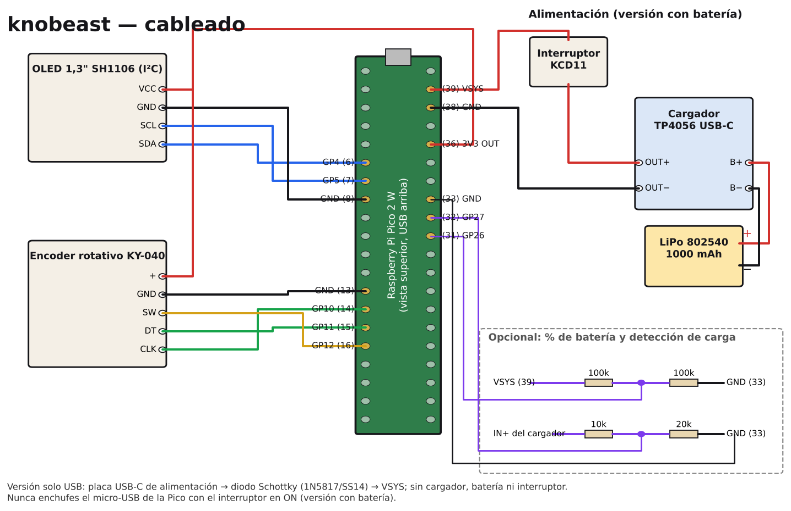
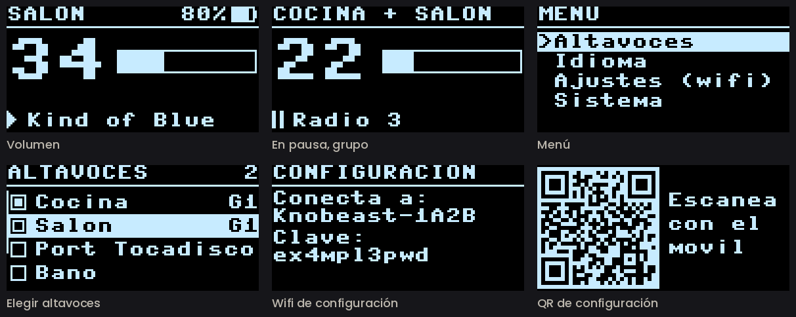
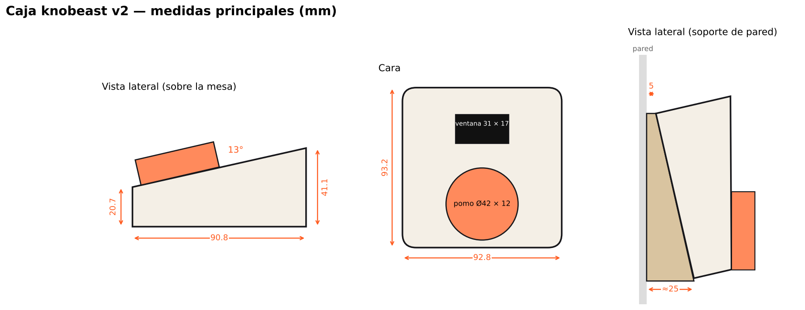

# Guía de montaje de knobeast

*[English version](build-guide.md)*

Esta guía explica cómo montar un knobeast desde cero: las piezas, el cableado, cómo grabar el programa, la configuración, la impresión de la caja y el montaje. Si prefieres no soldar ni programar, puedes comprarlo montado en [knobeast.com](https://knobeast.com/#comprar).

---

## 1. Piezas

| Pieza | Notas |
|---|---|
| Raspberry Pi Pico 2 W | Con wifi. El programa está hecho y probado para la Pico 2 W (RP2350) |
| Encoder rotativo KY-040 | Con pulsador. Eje en «D» de 6 mm (o moleteado: cambia `shaft` en el `.scad`) |
| Pantalla OLED 1,3" SH1106, I²C | La de 4 pines (VCC, GND, SCL, SDA), 128 × 64 |
| 2 tornillos M2 × 5 autorroscantes | Para sujetar la pantalla desde dentro |
| 4 tornillos M3 × 8 avellanados | Para cerrar la tapa inferior |
| 4 patas de goma Ø10 mm | Opcional |
| Cable fino, soldador y estaño | |

**Versión con batería**
- Cargador TP4056 con USB-C (17 × 26 mm, tipo HW-373, con protección). **Elige uno con las dos resistencias de 5,1 kΩ en las patillas CC del USB-C** (marcadas «512» junto al conector): muchas HW-373 no las llevan y entonces no cargan con cables y cargadores USB-C a USB-C, solo con USB-A a USB-C;
- batería LiPo 802540 de 1000 mAh;
- interruptor mini KCD11 (hueco de 8,8 × 13,2 mm).

**Versión solo USB-C**
- Una placa USB-C solo de alimentación, con las resistencias de 5,1 kΩ en CC;
- un diodo Schottky 1N5817 o SS14.

**Soporte de pared (opcional)**
- 8 imanes de neodimio de Ø10 × 3 mm;
- 2 tornillos de Ø4 con tacos.

**Opcional: % de batería y aviso de carga**
- 2 resistencias de 100 kΩ, una de 10 kΩ y una de 20 kΩ.

## 2. ⚠️ Una regla importante (versión con batería)

**Nunca enchufes el micro-USB de la Pico con el interruptor en ON.** Los 5 V del USB irían directos a la batería, sin control de carga.

Para programarla: interruptor en **OFF**, enchufas el USB, programas, desenchufas y vuelves a ponerlo en **ON**. Para cargar se usa siempre el USB-C del cargador, nunca el de la Pico.

## 3. Cableado



La Pico tiene los pines numerados del 1 al 40.
- El **1** está junto al micro-USB, en un lado, y el **40** también junto al micro-USB, en el lado contrario.
- Del 1 al 20 van por un borde y del 21 al 40 por el otro.

**Alimentación (versión con batería)**

| Desde | Hasta |
|---|---|
| Batería, cable **rojo** | Cargador **B+** |
| Batería, cable **negro** | Cargador **B−** |
| Cargador **OUT+** | Interruptor, una pata |
| Interruptor, la otra pata | Pico **VSYS** (pin 39) |
| Cargador **OUT−** | Pico **GND** (pin 38) |

Los pads **IN+ / IN−** del cargador no se usan para alimentar: la corriente entra por su USB-C.

**Alimentación (versión solo USB-C)**
- **VBUS** de la placa USB-C → diodo Schottky, con la raya hacia la Pico → **VSYS** (pin 39).
- **GND** de la placa USB-C → GND (pin 38).
- Con el diodo, en esta versión sí se puede enchufar a la vez el micro-USB de la Pico.

**Pantalla OLED**

| OLED | Pico |
|---|---|
| VCC | **3V3 OUT** (pin 36) |
| GND | GND (pin 8) |
| SDA | GP4 (pin 6) |
| SCL | GP5 (pin 7) |

**Encoder KY-040**

| KY-040 | Pico |
|---|---|
| + | **3V3 OUT** (pin 36), junto con el VCC de la pantalla |
| GND | GND (pin 13) |
| CLK | GP10 (pin 14) |
| DT | GP11 (pin 15) |
| SW | GP12 (pin 16) |

**% de batería (opcional)**

VSYS (pin 39) → 100 kΩ → **GP26 (pin 31)** → 100 kΩ → GND (pin 33). El programa la detecta solo (desde la 2.0.3): no hay que tocar `pico/config.py`.

**Aviso de carga (opcional)**

Pad **IN+** del cargador → 10 kΩ → **GP27 (pin 32)** → 20 kΩ → GND (pin 33). También se detecta solo. Con el USB-C enchufado, la pila de la pantalla sale con un rayo.

## 4. Probar desde el ordenador (opcional)

Antes de montar, puedes comprobar que tu ordenador ve tus Sonos y mueve el volumen igual que lo hará el mando:

```
python3 prueba_mac.py --lista              # habitaciones, grupos e identificadores
python3 prueba_mac.py Salón --mover        # sube y baja 2 puntos en el Salón
```

## 5. Grabar la Pico

1. Interruptor en **OFF**. En la carpeta del proyecto, ejecuta:

   ```
   bash instalar_mac.sh
   ```

   Te pedirá que mantengas pulsado **BOOTSEL** al conectar la Pico. Entonces:
   - descarga la última versión estable de MicroPython y la graba;
   - copia el programa;
   - muestra la identidad del mando, con su contraseña de configuración.
2. Desenchufa la Pico y pon el interruptor en **ON**. Como aún no conoce ninguna wifi, entra sola en configuración.

Después, para copiar solo el programa: `bash instalar_mac.sh --solo-programa`. Para ver qué hace: `python3 -m mpremote` (se sale con Ctrl+X).

`instalar_mac.sh` está hecho para macOS. En Linux o Windows usa directamente `mpremote` para copiar `pico/*.py`.

## 6. Configuración y menú



**Primera configuración**
1. El mando crea una red wifi **«Knobeast-XXXX»** con una **contraseña propia de cada aparato**. La pantalla alterna entre el nombre y la contraseña escritos y un **código QR**.
2. Escanea el QR con el móvil o conéctate a mano. La página se abre sola; si no, abre `192.168.4.1`.
3. Elige tu wifi (de 2,4 GHz), escribe la contraseña y pulsa **Guardar y reiniciar**. En la misma página puedes ajustar:
   - el volumen máximo;
   - el paso de volumen;
   - el atenuado y el apagado de la pantalla;
   - el idioma.

La contraseña de la red de configuración se crea en el primer arranque y no cambia nunca. Se puede imprimir en una pegatina debajo de la caja.

**Altavoces y menú:** mantén la rueda pulsada y sale una barra. Si sueltas pasados **2 s**, eliges altavoces; si sigues hasta los **4 s**, se abre el menú. Gira para elegir y pulsa para entrar; el menú acaba en *Volver*.
- **Altavoces:** marca uno o varios altavoces o grupos y pulsa **Guardar**.
  - **G1, G2…:** habitaciones agrupadas en Sonos.
  - **?:** elegida, pero ahora no aparece.
  - Los altavoces con el mismo nombre se distinguen por modelo.
  - Si las marcadas forman exactamente un grupo de Sonos, mueve el volumen del grupo. Si no, sube y baja lo mismo en cada una.
- **Idioma:** español, inglés, francés, alemán, italiano o portugués.
- **Ajustes (wifi):** vuelve a abrir la página de configuración.
- **Sistema:**
  - **Actualizar** y **Act. auto**: solo aparecen si el mando tiene actualizaciones por internet (edición oficial o tu propio servidor);
  - **Atenuar** y **Apagar** (tiempos de pantalla);
  - **Información:** versión e identificador;
  - **Restablecer:** borra wifi y ajustes;
  - **Reiniciar**.

**Atajo:** si lo enciendes con la rueda pulsada, entra directamente en la configuración.

**Salida fija:** un Sonos Port con la salida de línea en **Fija** no deja cambiar su volumen. Ponla en **Variable** en la app de Sonos.

## 7. Actualizaciones

Esta es la **edición comunidad**: no busca actualizaciones ni se conecta a ningún servidor. Las novedades se publican en este repositorio y cada uno actualiza su mando cuando quiere. Los knobeast que se venden montados en knobeast.com son la edición oficial, con actualizaciones automáticas.

### Actualizar a mano
1. Descarga la última versión de GitHub (`git pull`, o *Code → Download ZIP*).
2. Cópiala al mando de una de estas dos formas:
   - **Por USB:** interruptor en OFF, Pico enchufada, y `bash instalar_mac.sh --solo-programa`.
   - **Sin cables:** menú → **Ajustes (wifi)**, abre `192.168.4.1` desde el móvil o el ordenador, y en **Actualizar el programa** sube los `.py` de `pico/`.

En los dos casos se conservan la wifi y los ajustes, y `config.py` no se toca. Si la versión nueva no arranca, el mando vuelve solo a la anterior. Si se queda colgado, apágalo y enciéndelo 3 veces seguidas.

### Tu propio servidor de actualizaciones (opcional)

Si quieres que tus mandos se actualicen solos con tus versiones:
1. `python3 publicar_actualizacion.py --crear-claves` crea dos archivos:
   - `firma/knobeast_privada.key`, tu clave privada. **No la subas nunca a ningún sitio** y haz copia de seguridad.
   - `firma/clave_publica.py`, con tu clave pública y tu dirección de actualizaciones (dominio de `.servidor.json`).
2. Graba los mandos con `bash instalar_mac.sh`. Al encontrar `firma/clave_publica.py`, la instala y el mando pasa a buscar actualizaciones.
3. Para cada versión:
   1. sube `BUILD` en `pico/version.py`;
   2. rellena `.servidor.json` con la IP, el usuario SSH, la carpeta web, la llave SSH y el dominio;
   3. ejecuta `python3 publicar_actualizacion.py`. Firma la versión, la empaqueta, genera el SBOM, la sube por SSH y comprueba la descarga.

Los mandos solo instalan lo firmado con tu clave, por HTTPS con el certificado verificado, y nunca una versión más antigua que la suya.

El propio MicroPython (el `.uf2`) no se actualiza así. Hace falta muy rara vez y requiere el cable USB.

## 8. Imprimir la caja


`caja/knobeast_caja.scad` es el diseño editable (OpenSCAD) y los STL ya están orientados para imprimir. PLA o PETG, capa de 0,2 mm, 3 perímetros, relleno del 20 %, **sin soportes**.

| Pieza | Cómo se imprime |
|---|---|
| `knobeast_1_carcasa.stl` | Con la cara sobre la cama (93 × 97 mm) |
| `knobeast_2_tapa_inferior.stl` | Plana |
| `knobeast_3_pomo.stl` | Boca abajo (Ø42 × 12 mm) |
| `knobeast_4_soporte_pared.stl` | Con la cara de la pared sobre la cama |



Antes de imprimir, mide con un calibre:
- **Agujeros de la pantalla:** el diseño usa 30,5 × 28,5 mm entre centros. Ajusta `oled_hole_dx` y `oled_hole_dy` si los tuyos son distintos.
- **Eje del encoder:** no debe sobresalir más de 11,5 mm de la cara. Si es más largo, córtalo.

En el `.scad` también puedes cambiar la inclinación (`theta`), añadir un rótulo en la cara (`label`) o quitar el logo (`logo_on`).

## 9. Montaje


1. **Pantalla:** cristal hacia la ventana, **pines y cables hacia el pomo**, con los cables por el hueco del marco. Inclínala, mete el borde de los pines bajo las dos pestañas de las esquinas, baja el otro borde sobre los dos pivotes y fíjala con los 2 tornillos M2 × 5. Aprieta con suavidad: tiene que entrar sin forzar.
2. **Encoder:** el eje por su agujero, con los pines del KY-040 hacia la derecha. Apriétalo con su tuerca por fuera y pon el pomo a presión.
3. **Interruptor:** a presión en el hueco de la parte trasera.
4. **Tapa inferior:**
   - **Batería:** delante a la izquierda, en su bandeja, con cinta de doble cara.
   - **Pico:** detrás a la izquierda, en sus 4 tetones.
   - **Cargador:** a la derecha, con el USB-C mirando hacia atrás, en la boca del túnel. Una gota de silicona evita que se mueva al desenchufar.
5. Cierra con los 4 tornillos M3 y pega las patas de goma.

**El cable USB-C:** el conector se mete por la ranura de la base y se desliza hacia dentro hasta enchufar. Sobre la mesa, el cable sale por detrás.


**En la pared**
1. Atornilla el soporte, con 2 tacos y tornillos de Ø4.
2. Pega 4 imanes en la tapa y 4 en el soporte, **con la polaridad contraria** para que se atraigan.
3. Pasa el cable por la ventana del soporte **antes** de enchufarlo. Baja por el canal trasero o entra en la caja de mecanismos.
4. La caja encaja por arriba en el soporte.

## 10. Si algo no va

| Síntoma | Solución |
|---|---|
| La rueda va al revés | `ENC_REVERSE = True` en `config.py` |
| La rueda salta de 2 en 2 o va a medias | `ENC_DIVIDER = 2` |
| La pantalla sale boca abajo | `OLED_ROTATE_180 = False` |
| La pantalla no enciende | Revisa SDA (pin 6), SCL (pin 7), VCC (pin 36) y GND |
| Se queda en «Conectando wifi» | Menú → Ajustes (wifi). Tiene que ser una red de 2,4 GHz |
| No aparece una habitación en Altavoces | Tiene que estar encendida y en la misma red. Prueba `prueba_mac.py --lista` |
| El volumen no se mueve | La salida de línea del Port tiene que estar en **Variable** |
| «Firma no valida» | La clave pública del mando no corresponde a tu clave privada |
| Tras actualizar no va bien | Apaga y enciende 3 veces: vuelve a la versión anterior |

Para más detalle: `bash diagnostico_mac.sh`, con la Pico por USB y el interruptor en OFF.

---

*Documentación bajo licencia [CC BY-SA 4.0](../LICENSES/CC-BY-SA-4.0.txt).*
